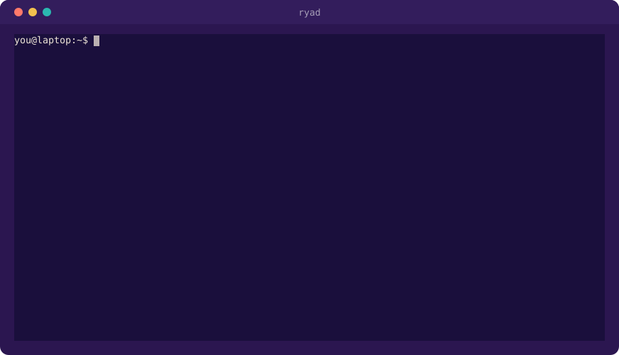
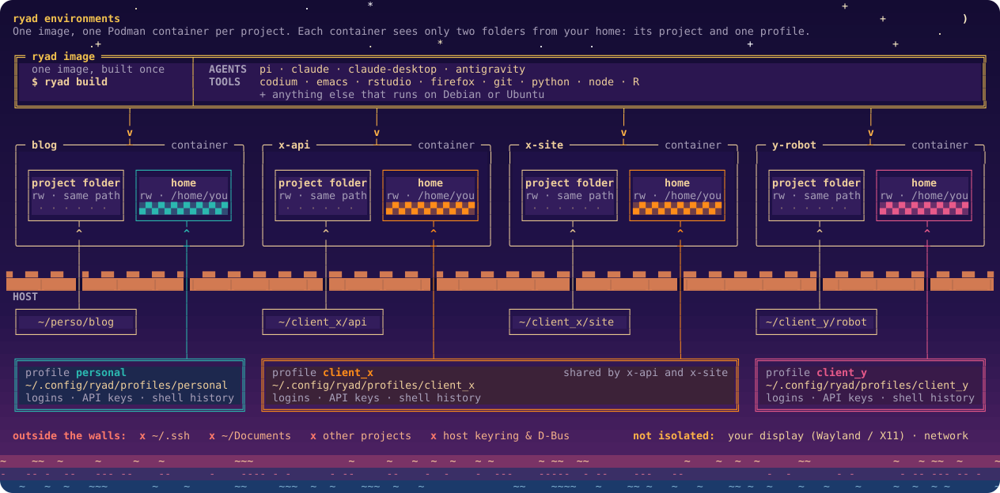

<p align="center">
  
</p>

<h1 align="center">ryad</h1>

<p align="center">
  <b>Same tools, separate rooms.</b><br>
  A calm way to use LLM-powered tools on Linux, one project at a time.
</p>

<p align="center">
  <a href="docs/getting-started.md">Getting started</a> ·
  <a href="docs/usage.md">Usage</a> ·
  <a href="docs/profiles.md">Profiles</a> ·
  <a href="docs/customization.md">Customization</a> ·
  <a href="docs/security.md">Security</a> ·
  <a href="docs/reference.md">Reference</a>
</p>

---

## Why ryad?

I work on quite a few different things: my own projects, and also professional projects for a handful of clients. I wanted two things that don't naturally go together:

- the **same tools everywhere**, set up once, not reinstalled for every project;
- each project kept **properly apart**. Client X's code, accounts and API keys have no business being near client Y's, and neither should be anywhere near my personal stuff.

On top of that, LLM-powered tools have a tendency to overflow outside of their expected playground : they run commands, install packages, edit files. That's what makes them useful, but I'd rather they did it somewhere other than my whole home directory.

So ryad gives each project its own **environment**, a small Podman container you step into from a terminal. Every environment is built from the same image, so your tools are always there. And each one only sees two things:

- its **project folder**, where the work happens;
- a **profile**: a home directory holding the logins, API keys and history for one context. One for your personal projects, one per client, or whatever split suits you.

Two projects, two profiles, each with its own prompt colors. Neither environment sees `~/.ssh` or the other project, and VSCodium starts in the background from the first one:

<p align="center">
  
</p>

Your SSH keys, your documents and your other projects stay outside.

And you can run apps with graphical interfaces like Claude Desktop, VS Codium, Firefox or whatever from each sandboxed environment.

```
      one image, the same tools in every room: pi, claude, codium, git…
 ┌──────────────────────┬──────────────────────┬──────────────────────┬──────────────────────┐
 │ environment "blog"   │ environment "x-api"  │ environment "x-site" │ environment "y-robot"│
 │ ~/perso/blog         │ ~/client_x/api       │ ~/client_x/sit e     │ ~/client_y/robot     │
 │ profile: personal    │ profile: client_x    │ profile: client_x    │ profile: client_y    │
 └──────────────────────┴──────────────────────┴─────────────────────────────────────────────┘
   none of them sees ~/.ssh, ~/Documents, or the others
```

<p align="center">
  
</p>

It doesn't matter which model or vendor you use. A few tools come preinstalled, and anything else that runs on Debian or Ubuntu can be added.


## What's inside

| | |
|---|---|
| **Agents** | [Pi](https://pi.dev) (`pi`, works with most model providers), Google Antigravity (`antigravity`), Claude Code (`claude`), Claude Desktop (`claude-desktop`) |
| **Editors** | VSCodium, Emacs, RStudio |
| **Browser** | Firefox, for sign-in pages and anything else that needs one |
| **Toolchains** | git, Python, Node.js, R, build-essential, ripgrep… |

GUI apps started inside the sandbox open on your normal Wayland or X11 desktop. Every app except Claude Code and Claude Desktop can be left out (`ryad apps rm rstudio`), and you can [add your own](docs/customization.md#add-a-third-party-app) (`ryad apps new mytool`). [Customization](docs/customization.md#ways-to-add-a-tool) compares the ways to add a tool.

## Try it

> [!WARNING]
> ⚠️ **Before you trust ryad with anything:** ⚠️
>
> - **Yes, it was almost entirely vibe coded**, written with LLM coding agents and only lightly reviewed. Expect bugs and rough edges. Beware.
> - **I'm not a security expert, and ryad hasn't been audited.** It reduces what your tools can reach; it isn't a hardened security boundary. Read the [Security model](docs/security.md) for what it doesn't isolate. Beware.
> - It comes **as is, without any warranty**, and you use it at your own risk. ryad is a personal project: my company, BERGIA Solutions, doesn't publish, distribute or support it, and accepts no liability for it. See [License](#license).


You need Linux with **rootless Podman**, plus `curl` and `jq`.

**1. Download** the installer of the [latest release](https://github.com/bcare-bergia/ryad/releases/latest), with its checksums and their signature:

```bash
v=$(curl -fsSL https://api.github.com/repos/bcare-bergia/ryad/releases/latest | jq -r .tag_name)   # e.g. v0.1.0
base=https://github.com/bcare-bergia/ryad/releases/download/$v
curl -fsSL --remote-name-all "$base/ryad-${v#v}.run" "$base/SHA256SUMS" "$base/SHA256SUMS.sig"
```

**2. Check** that they come from the author and arrived intact. The signature must come from one of the SSH keys published at [github.com/bcare-bergia.keys](https://github.com/bcare-bergia.keys), and the installer must match its checksum:

```bash
curl -fsSL https://github.com/bcare-bergia.keys | sed 's/^/bcare-bergia /' > allowed_signers
ssh-keygen -Y verify -f allowed_signers -I bcare-bergia -n file -s SHA256SUMS.sig < SHA256SUMS   # Good "file" signature…
sha256sum --ignore-missing -c SHA256SUMS                                                          # ryad-X.Y.Z.run: OK
```

**3. Install.** The installer shows the license, then puts `ryad` in `~/.local/bin`, with its shell completion and these docs. It never touches your profiles, settings, images or environments.

```bash
bash ryad-${v#v}.run
ryad --version
```

To upgrade later, do the same with the newer release. `bash ryad-X.Y.Z.run --help` lists the installer's options: another `--prefix`, `--uninstall`…

**4. Build the image** (a few GB, it takes a while the first time) **and step into a project:**

```bash
ryad build
cd ~/projects/acme
ryad
```

The last command creates the environment "acme" and opens a shell in it. From there, start whichever tool you like:

```console
you@acme:~/projects/acme$ pi            # or claude, antigravity, codium …
```

See [Getting started](docs/getting-started.md) for the details, including how to install from this repository instead.

## Examples

**Keep clients apart.** Each profile has its own logins, keys and history.

```bash
cd ~/clients/x/api  && ryad --profile=client-x
cd ~/clients/y/site && ryad --profile=client-y
cd ~/perso/blog     && ryad --profile=personal
```

**Or give an environment a name of your own.** By default an environment is named after its folder, but you can name it yourself when you create it, along with its folder and profile. From then on, the name is all it takes to step back in, wherever you are:

```bash
ryad projectx --workspace ~/code/projectx --profile=personal   # create it, and step in
ryad projectx                                                  # later, from any folder
```

Without `--workspace`, the new environment gets the current folder, and ryad asks first, so a typo doesn't quietly create a new environment.

**Open another terminal in the same environment**, from any folder:

```bash
ryad acme
```

**Start an app in the background** and get your terminal back:

```bash
ryad acme -d -- antigravity
ryad -d -- codium .                 # the environment of the current folder
```

**Run a single command** instead of opening a shell:

```bash
ryad acme -- pi -p "list the TODOs in this repository"
```

**Add your own tools to the image:**

```bash
echo "postgresql-client" >> ~/.config/ryad/packages/50-mine.list
ryad build && ryad recreate acme
```

**Upgrade every app** in every environment:

```bash
ryad build && ryad recreate --outdated
```

## Documentation

| Guide | |
|---|---|
| 🚀 [Getting started](docs/getting-started.md) | Requirements, installation, first build, first environment, logging in |
| 🧭 [Usage](docs/usage.md) | Entering environments, starting apps, managing environments day to day |
| 👤 [Profiles](docs/profiles.md) | Logins and API keys, sharing a profile between projects, prompt colors |
| 🎨 [Customization](docs/customization.md) | Adding packages and apps, pinning versions, changing the base image |
| 🔄 [Upgrading](docs/upgrading.md) | Getting new app releases and security updates |
| 🔒 [Security model](docs/security.md) | What is isolated and what isn't |
| 🧱 [Foundations](docs/foundations.md) | How ryad works under the hood, repository layout |
| 📖 [Reference](docs/reference.md) | Every command, option, setting and file |
| 🩺 [Troubleshooting](docs/troubleshooting.md) | Common problems and fixes |

## License

ryad is © 2026 Bertrand Caré, under the [Sustainable Use License 1.0](LICENSE.md). In plain words:

| | |
|---|---|
| ✅ **You may** | use and modify ryad for yourself, or for your own business: client work as a freelancer, or internal use in a company, is fine. Share it, free of charge and for non-commercial purposes |
| ❌ **You may not** | sell ryad or a fork of it, offer it as a paid product or service (hosting included), or remove its license notices |

This makes ryad *source-available*, not open source in the OSI sense. This summary isn't legal advice: the text of [LICENSE.md](LICENSE.md) is what counts. For any other use, ask the author.

ryad comes as is, without any warranty, and its author accepts no liability for it. BERGIA Solutions, the author's company, isn't the licensor: it doesn't publish, distribute or support ryad, and accepts no liability in relation to it either. The apps ryad installs keep their own licenses.
